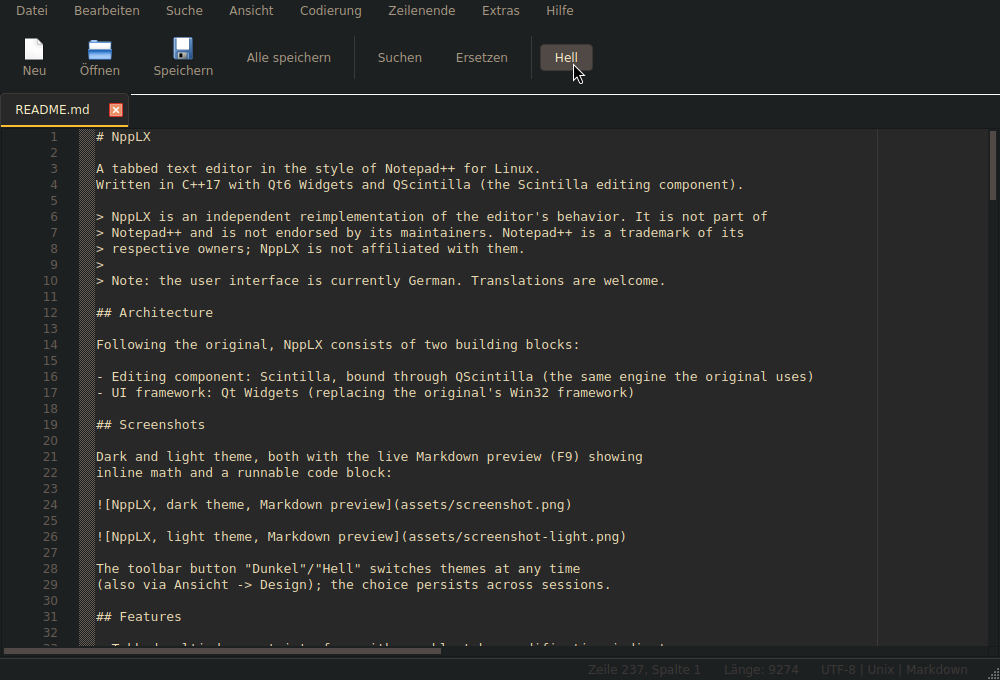
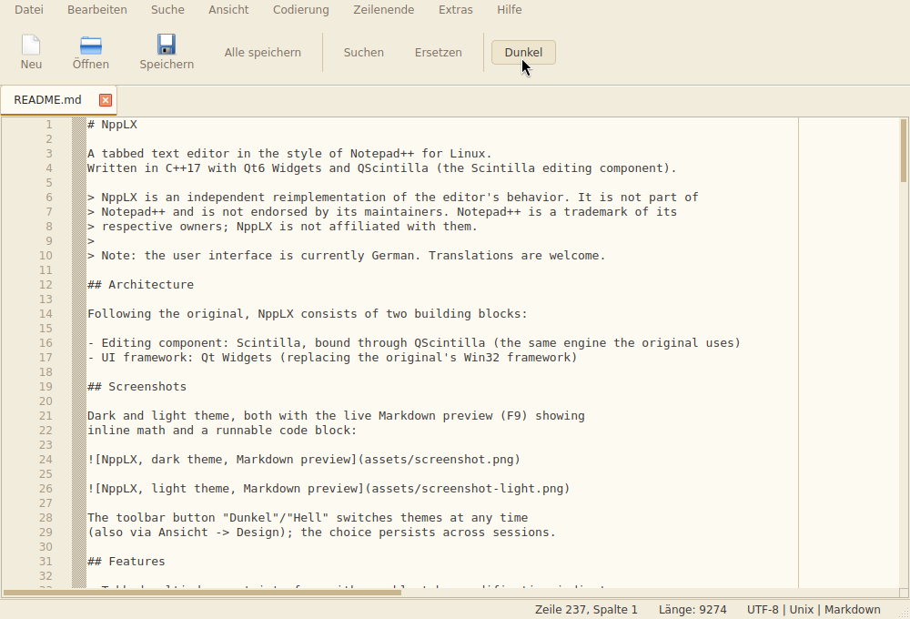

# NppLX

A tabbed text editor in the style of Notepad++ for Linux.
Written in C++17 with Qt6 Widgets and QScintilla (the Scintilla editing component).

> NppLX is an independent reimplementation of the editor's behavior. It is not part of
> Notepad++ and is not endorsed by its maintainers. Notepad++ is a trademark of its
> respective owners; NppLX is not affiliated with them.
>
> Note: the user interface is currently German. Translations are welcome.

## Architecture

Following the original, NppLX consists of two building blocks:

- Editing component: Scintilla, bound through QScintilla (the same engine the original uses)
- UI framework: Qt Widgets (replacing the original's Win32 framework)

## Screenshots

Dark and light theme (Gruvbox-inspired studio palette), both with the
live Markdown preview (F9) showing inline math and a runnable code block:





The toolbar button "Dunkel"/"Hell" switches themes at any time
(also via Ansicht -> Design); the choice persists across sessions.

## Features

- Tabbed multi-document interface with movable tabs, modification indicators
  and session restore (open files, window geometry)
- Recently opened files
- Find/replace: case sensitivity, whole-word, regular expressions, forward and
  backward search, "replace all" as a single undo action
- Find all: result list in a dock, click to jump to the match
- Find in files (Ctrl+Shift+F): recursive folder search with file name filter;
  binary and oversized files are skipped
- Syntax highlighting for 20 languages (Python, C++, C#, Java, JavaScript,
  HTML, XML, CSS, JSON, Markdown, YAML, INI, Bash, SQL, Makefile, CMake,
  Lua, Ruby, Pascal, Diff)
- Line numbers, code folding, bracket matching, auto-completion
- Live Markdown preview (F9): renders headings, lists, tables, code blocks,
  quotes, links, emphasis and inline math while you type
- PDF export: File -> "Export as PDF ..." or from the header bar of the
  Markdown view; Markdown is rendered, other files are exported as plain text;
  print output supported as well (Ctrl+P)
- Headless command-line converter (no GUI required, works on servers):

```
npplx --to-pdf input.md                   # writes input.pdf next to it
npplx --to-pdf input.md output.pdf
npplx --to-pdf notes.txt letter.pdf --plain   # always plain text
```

- Line operations: duplicate line (Ctrl+D), delete line (Ctrl+L),
  move line (Ctrl+Shift+Arrow), sort lines, remove duplicate lines,
  trim whitespace
- Case conversion: upper (Ctrl+U), lower (Ctrl+Shift+U), title case
- Line comment toggle (Ctrl+Q; language-dependent #, // or --)
- Bookmarks in the margin: toggle (Ctrl+F2), jump (F2 / Shift+F2), clear all
- Document statistics (lines, words, characters, selection)
- Line-ending detection and conversion (Unix/Windows/Mac)
- UTF-8/ANSI (Latin-1) encoding with automatic fallback detection
- Light and dark themes (one-click toggle in the toolbar, design menu,
  persisted across sessions), zoom, status bar
- Fullscreen (F11) and always-on-top (F12)

## Requirements

Qt >= 6.2 (Widgets, PrintSupport) and QScintilla >= 2.13 (Qt6 variant).
Linux with X11 or Wayland; the command-line converter also works fully headless.

## Installation

### From a release (.deb, Debian/Ubuntu, amd64)

Download the `npplx_X.Y.Z-1_amd64.deb` from the
[releases page](https://github.com/Jonny-IT1/NppLX/releases) and install it:

```
sudo apt install ./npplx_1.2.1-1_amd64.deb
```

Requires Qt >= 6.8 from your distribution's repositories.
Removal: `sudo apt remove npplx`.

### From source (install.sh)

The bundled script installs missing dependencies (detected package manager:
Debian/Ubuntu, Arch, Fedora, openSUSE), builds NppLX in `build/` and
installs binary, menu entry and icon to /usr/local:

```
gh repo clone Jonny-IT1/NppLX   # or: git clone https://github.com/Jonny-IT1/NppLX.git
cd NppLX
./install.sh
```

Install into the user directory without root (prefix with PREFIX):

```
PREFIX="$HOME/.local" ./install.sh
```

Uninstall (uninstall.sh):

```
./uninstall.sh            # removes binary, menu entry and icon from all common prefixes;
                           # also detects and removes a Debian package installation
./uninstall.sh --purge    # additionally removes the entire project directory (source and build)
```

The cloned project directory does not need to be kept after installation:
binary, menu entry and icon live independently in the system. The directory
only serves convenient maintenance (updates via git pull + ./install.sh).
The Debian package can alternatively be removed directly: sudo apt remove npplx.

### Manual build

```
# Debian/Ubuntu
sudo apt install build-essential cmake pkg-config qt6-base-dev libqscintilla2-qt6-dev

# Arch/Manjaro
sudo pacman -S base-devel cmake qt6-base qscintilla-qt6

# Fedora
sudo dnf install gcc-c++ make cmake qt6-qtbase-devel qscintilla-qt6-devel
```

```
cmake -B build -DCMAKE_BUILD_TYPE=Release
cmake --build build -j$(nproc)
./build/npplx [file1 file2 ...]
```

Without CMake, direct translation (Debian/Ubuntu; the pkg-config name of
QScintilla is distribution-specific, hence the explicit library here):

```
g++ -std=c++17 -O2 -o npplx main.cpp \
    $(pkg-config --cflags --libs Qt6Widgets Qt6PrintSupport) \
    -lqscintilla2_qt6
```

## Command-line PDF converter

```
npplx --to-pdf <input-file> [output-file] [--plain]
```

- Files ending in .md, .markdown, .mdown or .mkd are rendered as Markdown;
  everything else is treated as plain text. --plain forces plain-text output
  for Markdown files as well.
- If no output file is given, the PDF is written next to the input file.
- Exit codes: 0 on success, 2 when no input file is given,
  1 on read or write errors.

## Inline math in Markdown

The preview and the PDF export render a practical TeX subset without any
external tools. Recognized delimiters: `$...$` (inline),
`$$...$$`, `\(...\)` and `\[...\]` (display)
as well as ```` ```math``` ```` fenced blocks.

Supported: Greek letters, operators and relations (`\pm`,
`\times`, `\leq`, `\neq`, `\approx`, ...),
fractions (`\frac`, `\tfrac`), roots with indices
(`\sqrt[3]{x}`), sub-/superscripts (including control words such
as `x^\infty`), `\mathbb`/`\mathbf`/`\text`,
sums, integrals and products with limits, primes and spacing commands;
unknown macros stay visible as plain text. HTML characters inside math
are escaped; a literal dollar sign is written as `\$`.

## Running code blocks in Markdown

Code fences labeled `python`, `c`, `cpp`, `sql` or
`sqlite` can be executed directly from the preview:

- python: the block runs with the configured Python interpreter
- c / cpp: the block is compiled with gcc / g++ into a fresh temporary
  directory and the resulting binary is executed
- sql / sqlite: the block is fed to sqlite3 with `.headers on`
  and `.mode column`

Execution is strictly opt-in: a run control appears only for supported
languages inside the preview, and nothing runs without an explicit
click. Program paths are absolute and configurable
(Extras -> "Werkzeuge für Code-Ausführung ..."); defaults are
/usr/bin/python3, /usr/bin/gcc, /usr/bin/g++ and /usr/bin/sqlite3.
Every process gets a fresh temporary directory, a 10 second timeout
and a 100 KB output cap; no shell is involved at any point, so there
are no shell escapes. Run controls never appear in exported PDFs.

## Testing

Each release is validated with an independent, evidence-based test pass:

- 1368 unit-level checks against the unmodified `main.cpp`
  (every functional group covered with more than 100 checks: static HTML
  primitives, Markdown renderer including the complete inline-TeX engine,
  code execution with real end-to-end runs of python, C, C++ and SQL blocks,
  PDF writer, line operations, case conversion, comments, bookmarks,
  search, statistics, GUI/tab management)
- A 316-case command-line corpus (Markdown and plain-text conversions,
  error cases, boundary cases including a 2 MB file, binary input,
  Latin-1, BOM and multi-page PDFs; every produced PDF verified with
  qpdf --check and content spot checks) plus a 113-case corpus for the
  math and code-fence features (glyph-level assertions in the extracted
  text, brace regressions with timeout guards, escaped-dollar checks,
  verification that run controls never leak into paper PDFs)
- GUI smoke test under Xvfb with window title verification and screenshot

## Third-party components

- [Qt 6](https://www.qt.io) - LGPL-3.0/GPL-3.0 (GPL-3 applies here)
- [QScintilla](https://riverbankcomputing.com/software/qscintilla) -
  Qt binding of the [Scintilla](https://www.scintilla.org) editing component,
  GPL-2.0/GPL-3.0 (GPL-3 applies here)
- [Notepad++](https://notepad-plus-plus.org) - behavior reference only;
  no source code was used or included

## Contributing

Bug reports and pull requests are welcome. Please keep the code style
(C++17, no external dependencies beyond Qt6 and QScintilla) and make sure
the project builds cleanly before submitting.

## License

GPL-3.0-or-later, see [LICENSE](LICENSE). NppLX is licensed under the GPL-3.0
because QScintilla is bound to the GPL; the Scintilla editing component must be
named as required by its license.
